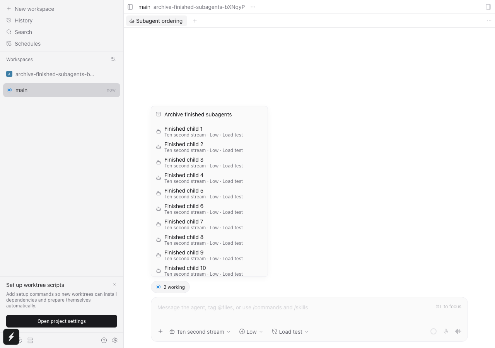
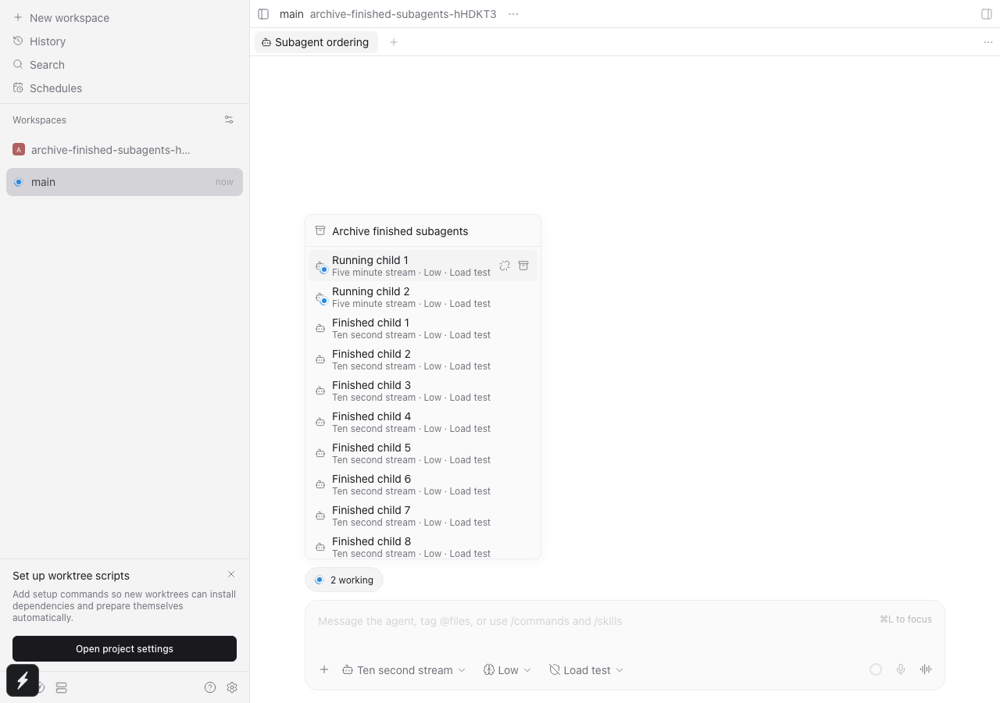
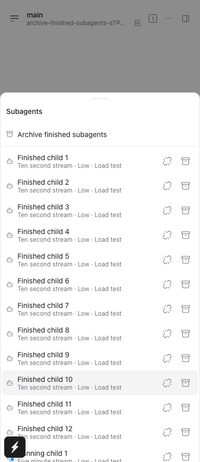
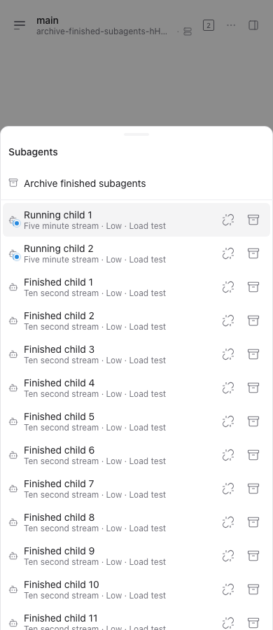

# Subagent track ordering QA

Baseline: 27d6b3b7ce7b380574b81a86720f4c8c53b6a918 (origin/main, 2026-10-26).

Real Chromium + isolated daemon using the repository mock provider. The test creates 12 idle children followed by two running children and opens the parent track. Before: first row is Finished child 1. After: Running child 1 and Running child 2 are first and in the viewport. Screenshots use synthetic test data.

- Wide browser: 1280 x 900
- Compact browser sheet: 390 x 900
- Both baseline order assertions failed.
- Updated archive-finished-subagents.spec.ts: 4 passed (31.8s), including two existing archive success/retry cases.
- Final screenshot/actionability run: 2 passed (24.1s).
- track-presentation.test.ts: 29 passed (29), 1 passed test file.
- npm run typecheck: all workspaces passed.
- npm run lint -- <four changed files>: Found 0 warnings and 0 errors.
- npm run format: Finished in 2216ms on 5390 files.

Not exercised: packaged Electron, iOS, Android, Windows or Linux UI. Compact browser is not native-device evidence. No claim of a lifecycle/status-sync fix.

## Screenshots

| Surface | Before | After |
| --- | --- | --- |
| Wide browser |  |  |
| Compact browser |  |  |
