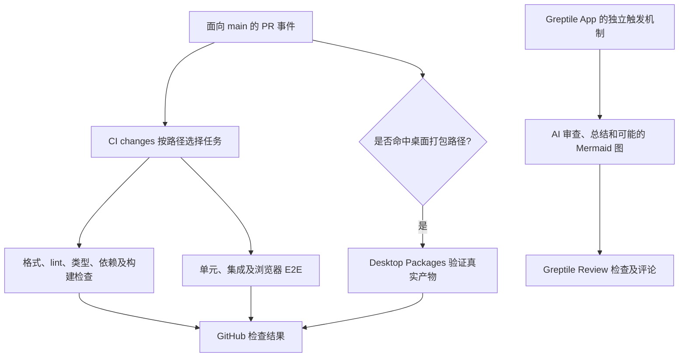
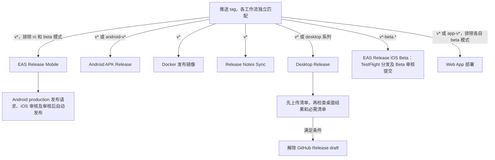

# Paseo 自动化工作流

核对日期：2026-10-16。配置基线：上游 `main` 的 [`d7b3ff654d88f2c7dabd1840b4a66e2441ab059a`](https://github.com/getpaseo/paseo/tree/d7b3ff654d88f2c7dabd1840b4a66e2441ab059a)。以下分析描述该提交中的配置，以及单独标明的 GitHub App 运行记录；不代表每次运行都成功。

## 范围与证据

纳入范围：仓库实际配置的 12 个 GitHub Actions、3 个 EAS 工作流，以及有运行记录的 Greptile 自动审查。`workflow_dispatch` 属于人工启动、随后自动执行的流水线，单独列出。

需求讨论、人工 Bug 排查、维护者接纳政策和手动 Agent skills 不属于本文范围。PR 的检查细节及历史实例见 [PR 审查流程](pr-review-workflow.md)；测试设计见 [testing.md](testing.md)，发布操作规程见 [release.md](release.md)。

配置证据来自 [GitHub Actions 目录](../.github/workflows) 和 [EAS 目录](../packages/app/.eas/workflows)。GitHub App 后台配置、分支保护、必需检查、自动合并开关、合并队列和外部部署平台设置未核验。文件中出现事件或步骤，不能单独证明对应后台配置或凭据已经就绪。

## 1. PR 自动验证

### CI

[ci.yml](../.github/workflows/ci.yml) 的入口是面向 `main` 的 `pull_request`、`main` 推送、`merge_group` 和手动运行。PR 未显式配置 `types`；按 [GitHub 默认规则](https://docs.github.com/en/actions/reference/workflows-and-actions/events-that-trigger-workflows#pull_request)，只响应 `opened`、`synchronize`、`reopened`。修改 base 分支属于 `edited`，不在默认范围内。配置 `merge_group` 也不能证明已启用合并队列。

`changes` 通过 `dorny/paths-filter` 读取 [ci-paths.yml](../.github/ci-paths.yml)。普通 PR 按路径选择合同；工作区、公共脚本、CI 路由等改动会扩大范围。`main`、合并组和手动运行走完整合同。相同 PR 的新 CI 会取消未完成的旧 CI。

| 自动检查                         | 工具与行为                                                                                                      |
| -------------------------------- | --------------------------------------------------------------------------------------------------------------- |
| CI 合同                          | Node test runner 验证工作流、启动及相关脚本合同                                                                 |
| 格式与代码规则                   | Oxfmt、Oxlint；检查不会自动格式化后提交                                                                         |
| 类型与包内容                     | 构建 server stack 后运行工作区 typecheck，另检查内置插件产物和 `npm pack --dry-run` 内容                        |
| 依赖来源与完整性                 | `lockfile-lint` 检查允许来源、HTTPS 和 integrity；`npm audit signatures` 验证签名                               |
| App / SDK / Server / Relay / CLI | Vitest 及各工作区测试脚本；CLI E2E 分 3 个分片                                                                  |
| 浏览器 E2E                       | Playwright，App 浏览器测试分 4 个分片；网站另有 Chromium/WebKit 测试                                            |
| 桌面 E2E                         | Electron、Playwright 和 Linux Xvfb；覆盖生命周期、renderer 和浏览器等合同                                       |
| 诊断附件                         | 部分任务上传报告、截图或诊断附件，配置保留 7 天；desktop lifecycle 截图在未取消时上传，其他部分诊断仅失败时上传 |

Server 合同有 Ubuntu、Windows 和范围较小的 macOS 文件观察测试；Desktop 合同有 Ubuntu 和 Windows。跳过任务不算运行通过；工作流等待审批或权限处理时，也不能当成代码测试失败或成功。

### Desktop Packages

[desktop-packages.yml](../.github/workflows/desktop-packages.yml) 在 `main` 推送时运行；PR 仅在改动 `packages/desktop/**`、`plugins/**`、`nix/**` 或该工作流时触发。当前是一个 Linux job，构建真实桌面产物并做安装、启动和 sandbox smoke。它不为每个 App UI PR 验证原生 Android/iOS。

### Greptile

Greptile 作为独立 GitHub App 发布检查和评论，不由 `ci.yml` 调用。仓库内没有它的完整配置，触发事件、重审策略、模型和内部工具链不能从 Actions 配置推断。

在 [PR #7153 的评论](https://github.com/getpaseo/paseo/pull/7153#issuecomment-6216465011) 及该 PR 的 Check Run 中，能确认它审查了提交 `5fbd9c41472606b62eebf64541dfb651e3cb604b`：检查 10 个文件，0 条逐行问题评论，发布摘要、5/5 置信评分和 Mermaid 源码，最终 Check Run 为 `success`。

流程图随 AI 总结评论发布，由 GitHub 渲染。公开证据不能定位 Greptile 内部生成图的具体阶段。评分和流程图不证明它运行过测试或实际启动过 App。

## 2. main 推送后的自动化

PR 合并产生的 `main` 推送会命中相应配置；直接推送到 `main` 也具有相同入口，不需要先存在 PR。

| 工作流                                                            | 额外条件                                                 | 自动执行与写入行为                                                                                                     |
| ----------------------------------------------------------------- | -------------------------------------------------------- | ---------------------------------------------------------------------------------------------------------------------- |
| [CI](../.github/workflows/ci.yml)                                 | 无路径过滤                                               | 执行完整 CI 合同                                                                                                       |
| [Desktop Packages](../.github/workflows/desktop-packages.yml)     | 无路径过滤                                               | 验证真实 Linux 桌面安装产物                                                                                            |
| [Docker](../.github/workflows/docker.yml)                         | 无路径过滤                                               | 从 checkout 源码构建 `linux/amd64`、`linux/arm64` 镜像；普通 main 推送 `push: false`，不发布到 GHCR                    |
| [Nix](../.github/workflows/nix.yml)                               | 无路径过滤                                               | 更新工作目录内需要的锁文件/hash，构建 Nix daemon/desktop，做 daemon smoke 和 macOS app bundle 验证；该工作流不提交修改 |
| [Nix Update Hash](../.github/workflows/nix-update-hash.yml)       | 命中列出的 Nix、依赖或相关源码路径                       | 更新锁文件/hash、验证构建；有差异时通过 GitHub App token 自动提交并推送                                                |
| [Deploy Website](../.github/workflows/deploy-website.yml)         | 命中官网、公共文档、CHANGELOG、protocol 或相关依赖等路径 | 构建、类型检查并部署网站到 Cloudflare Workers                                                                          |
| [Release Notes Sync](../.github/workflows/release-notes-sync.yml) | `CHANGELOG.md` 变化                                      | 将匹配的 changelog 条目同步到 GitHub Release                                                                           |

Docker 和 Nix 当前没有 `pull_request` 入口。即使发布文档概括了 PR 构建，也应以这两个 YAML 的实际事件配置为准。

Nix Update Hash 是已经配置的自动改文件、提交流程，范围仅是 `package-lock.json` 和 `nix/npm-deps.hash`。它使用 GitHub App token 推送，但提交带 `[skip ci]`；按 [GitHub 跳过运行规则](https://docs.github.com/en/actions/how-tos/manage-workflow-runs/skip-workflow-runs)，该提交不会启动本应匹配的 `push` 工作流，包括 main 上的 CI、Docker、Nix、Desktop Packages 等。此跳过指令不适用于所有事件类型，也不表示这些任务执行通过。它不是 AI 通用修复器，不会自动修改 PR 业务代码。

Docker 的 [Dockerfile](../docker/base/Dockerfile) 复制 checkout 源码、打包工作区并安装本地产物；`PASEO_VERSION` 用于版本一致性校验，不能把它误读为从 npm 下载同版本旧代码进行验证。

## 3. 发布 tag 驱动的自动化

边上的过滤条件独立求值，可以同时命中多条路径。完整模式以下表为准；执行结果不是单一的原子发布事务。

| 工作流                                                                  | 自动触发规则                                                                     | 自动执行的结果                                                                                                           |
| ----------------------------------------------------------------------- | -------------------------------------------------------------------------------- | ------------------------------------------------------------------------------------------------------------------------ |
| [Desktop Release](../.github/workflows/desktop-release.yml)             | `v*`、`desktop-v*`、`desktop-macos-v*`、`desktop-linux-v*`、`desktop-windows-v*` | 按 tag 选择平台，构建上传桌面产物；finalize 汇总、校验并上传更新清单，满足条件后解除 Release draft                       |
| [Android APK Release](../.github/workflows/android-apk-release.yml)     | `v*`、`android-v*`                                                               | Actions 调用 EAS Build 云端构建 APK，下载并上传 GitHub Release；必要时自己创建 draft，不等待或参与 Desktop finalize 门槛 |
| [Docker](../.github/workflows/docker.yml)                               | `v*`                                                                             | 构建并发布 GHCR 双架构镜像；无 `-` 的版本更新版本标签及 `latest`，含 `-` 的预发布版本仅更新版本标签                      |
| [Release Notes Sync](../.github/workflows/release-notes-sync.yml)       | `v*`                                                                             | 同步发布说明，必要时创建 draft Release                                                                                   |
| [Deploy App](../.github/workflows/deploy-app.yml)                       | `v*` 或 `app-v*`，排除对应的 `*-beta.*`                                          | 构建依赖、类型检查并部署 Web App 到 Cloudflare Pages                                                                     |
| [Release Mobile](../packages/app/.eas/workflows/release-mobile.yml)     | `v*`，排除 `v*-rc.*` 和 `v*-beta.*`                                              | EAS 并行构建；Android 请求 production 轨道 completed 发布；iOS 上传并提交审核，设置审核后自动发布和尝试撤回在审旧提交    |
| [Release iOS Beta](../packages/app/.eas/workflows/release-ios-beta.yml) | `v*-beta.*`                                                                      | EAS 构建 iOS，分发到 `Paseo Beta` 外部组，并提交 Beta App Review                                                         |

注意以下执行边界：

- Deploy App 只显式排除 Beta，没有排除 RC；不能概括为“所有预发布 tag 都不部署 Web App”。
- Desktop Release 默认写入 36 小时 rollout 参数，客户端依据更新清单放量。finalize 会先删除失败平台的旧清单、重新 stamp 并上传可用清单，再检查平台结果和必需清单；`skipped` 平台允许复用已有清单。若 Release 仍为 draft，检查失败会保留 draft。对已发布 Release 的单平台重跑没有这个保护，上传或删除清单可直接影响客户端，且复用清单的 releaseDate 也会重新 stamp。这不是跨平台原子更新。
- Deploy Website 还监听 `release.published`，并排除 prerelease/draft。基线 Desktop Release finalize 使用 `GH_TOKEN: secrets.GITHUB_TOKEN` 执行 `gh release edit --draft=false`；按 [GitHub token 事件规则](https://docs.github.com/en/actions/concepts/security/github_token)，这种身份产生的 Release 事件不会启动新的 Actions 运行，所以这一步不会触发 Deploy Website。用维护者身份或 PAT/GitHub App token 发布的匹配 Release 才可能走这个入口；网站另有 main 推送的路径过滤入口。此结论由配置和平台规则推导，未核对线上运行记录。
- EAS 工作流由独立的 EAS GitHub 集成执行，位于 `packages/app/.eas/workflows/`，不是 GitHub Actions job；需要 EAS 项目已关联仓库，该后台设置未核验。Actions 中的 Android APK 流程也会调用 EAS 云端构建，但不属于这 3 个 EAS workflow 文件。
- Desktop finalize 只检查桌面平台与更新清单，不等待 APK 上传；GitHub Release 公开时，Android APK 可能还在构建或已经失败。Android 的 `production` 和 `production-apk` profile 还显式跳过了若干 Gradle lint 任务，不能把 APK/AAB 构建成功当成原生 lint 通过。
- [eas.json](../packages/app/eas.json) 的 Android 提交配置为 `track: production`、`releaseStatus: completed`，请求生产轨道发布。[Fastfile](../packages/app/fastlane/Fastfile) 的 iOS `submit_review` 设置 `automatic_release: true`，审核通过后自动发布；`reject_if_possible: true` 会尝试撤回可撤回的在审旧提交，发布说明固定为 `Bug fixes and improvements.`。手动重新送审也复用此 lane。
- 商店上传、提交审核、审核通过和实际上线是不同状态；自动发布配置不能证明已经上线。Google 审核、Play Console 托管发布以及 App Store 后台状态未核验。

## 4. 人工启动后自动执行

下列流水线只有 `workflow_dispatch` 入口：

| 工作流                                                                                      | 自动执行内容                                                                                                  |
| ------------------------------------------------------------------------------------------- | ------------------------------------------------------------------------------------------------------------- |
| [Desktop Rollout](../.github/workflows/desktop-rollout.yml)                                 | 下载已有 Release 的更新清单，修改 rollout 时长并上传；不重新构建，保留原始 releaseDate                        |
| [Resubmit iOS for App Store review](../packages/app/.eas/workflows/resubmit-ios-review.yml) | 对指定或最近的既有 iOS 构建重新提交审核；沿用审核后自动发布及尝试撤回在审旧提交的配置，不重新构建或上传二进制 |
| [Deploy Relay](../.github/workflows/deploy-relay.yml)                                       | 运行仓库内 Cloudflare Worker/桥接部署；当前生产 Elixir Relay 是另一仓库的发布流程                             |

CI、Docker、Desktop Release、Android APK Release、Deploy App、Deploy Website、Release Notes Sync 和 EAS Release Mobile 也支持手动入口。手动参数可能改变是否发布、选择的平台、版本和灰度参数，不能直接套用 tag 自动触发时的行为。

Relay 的基线资料存在冲突：`release.md` 将 Cloudflare 工作流描述为 legacy/不用于生产；`deploy-relay.yml` 注释和 `packages/relay/wrangler.toml` 又保留了转发到 Fly 服务的桥接配置。这里只确认有一个手动 Cloudflare Worker 部署入口，不据此断言桥接是否在线；生产 Elixir Relay 的独立发布过程不在本仓库内。

## 5. 失败、重跑和修改边界

| 信号                       | 自动化实际提供什么                                                                                   | 没有覆盖什么                                           |
| -------------------------- | ---------------------------------------------------------------------------------------------------- | ------------------------------------------------------ |
| CI 断言或构建失败          | 失败检查、日志，以及部分任务的附件                                                                   | 没有通用的自动改代码或提交修复步骤                     |
| PR 更新提交                | 匹配的 CI 重新运行，旧运行可被取消                                                                   | 不保证独立 GitHub App 采用相同重审策略                 |
| Greptile 报告问题          | AI 意见、总结和检查结果                                                                              | 未证明会自动生成修复、运行测试或合并                   |
| 安装依赖出现瞬时故障       | `scripts/npm-retry.mjs` 在其限定范围内重试                                                           | 不表示失败测试被自动重跑到通过                         |
| 桌面平台发布失败           | finalize 上传清单后检查结果；Release 仍为 draft 时阻止解除 draft，已发布版本的清单写入不受此门槛保护 | 不负责撤销其他独立流水线已经发布的 npm、镜像或商店构建 |
| 需要调整发布参数或重新送审 | 配置了相应手动工作流                                                                                 | 没有自动决定调整参数或重送审的规则                     |

执行要对齐具体 SHA、事件、过滤结果和产物。`skipped`、`action_required`、AI 检查成功、实际测试通过和真实产物可用应分别记录。

## 6. 未纳入“已配置自动化”的能力

- Hub 支持事件触发 Agent、Issue/PR 处理和多步执行，但该基线没有提交 `.paseo/` 自用配置，不能证明 Paseo 仓库已启用这些流程。相关配置版本差异见 [Hub relationship](hub.md)。
- Schedule 和 Heartbeat 支持周期任务及持续跟进，但能力文档或发布规程要求不等于有正在运行的任务记录。
- 需求自动拆解、Bug 自动分类、通用 AI 修复和自动合并，没有在本次检查的仓库配置中找到完整闭环。外部 App 或后台可能另有设置，本次不推断其存在或不存在。

因此，可确认的自动化重点是验证、打包、交付，以及有限范围的依赖维护。本文不把产品能力、人工规程或文档示例当成已启用的自动化。
