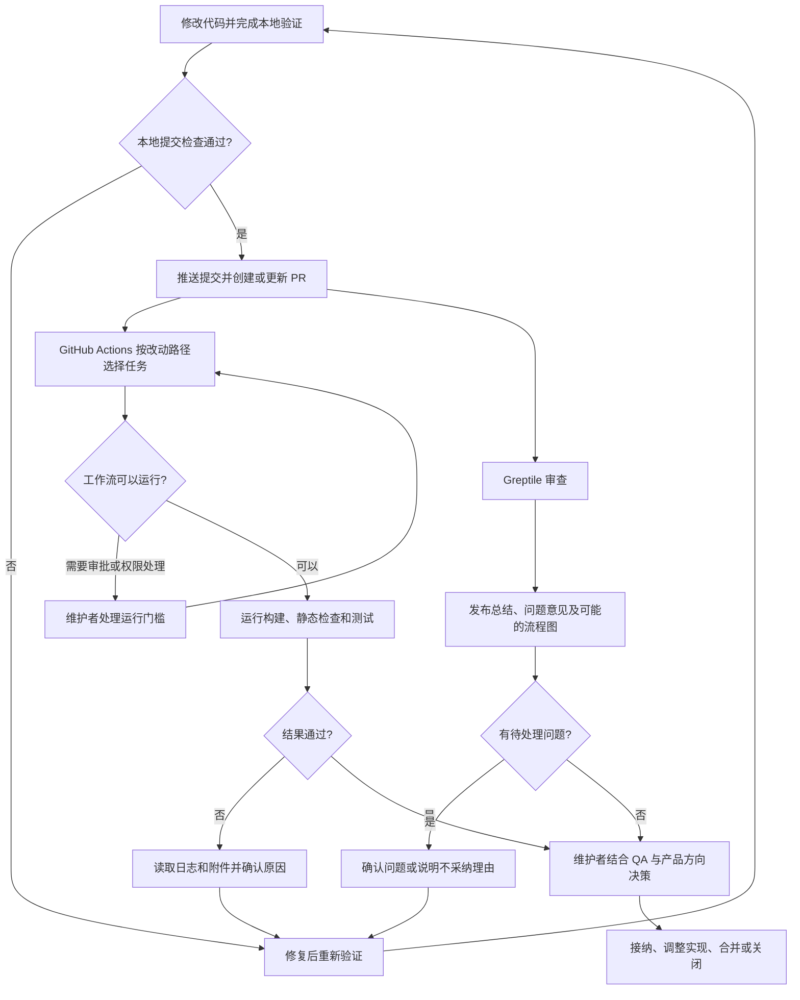

# PR 自动验证、AI 审查与合并流程

核对日期：2026-10-16。仓库配置基线：[`c1558d29e`](https://github.com/getpaseo/paseo/tree/c1558d29eab78c898743adb613afa01ba4f0e780)。GitHub App 配置、仓库权限与分支规则可能独立变化；排查具体 PR 时重新读取其检查、工作流和评论。

Paseo 使用 GitHub Actions 执行自动验证，Greptile GitHub App 提供 AI 代码审查，维护者决定是否接纳及合并。已检查的仓库配置没有提供“发现问题后自动修改代码、提交修复并合并”的完整闭环。

跨 PR、main 推送、发布和部署的配置清单见 [自动化工作流](automation-workflows.md)。本文保留 PR 审查细节与历史实例。

## 入口与职责

| 环节         | 执行方         | 产物与边界                                                        |
| ------------ | -------------- | ----------------------------------------------------------------- |
| 本地提交检查 | Lefthook       | 格式、lint、类型检查；本地安装并启用 hook 后生效，不能替代上游 CI |
| 自动验证     | GitHub Actions | 对具体提交运行构建、检查和测试，报告成功、失败、跳过或需要操作    |
| AI 代码审查  | Greptile       | 审查评论、总结、置信评分、可能的流程图及检查结果                  |
| 问题修复     | 提交者或维护者 | 判断报告是否成立，修改代码、补测试及更新证据                      |
| 接纳与合并   | 维护者         | 根据产品方向、维护成本、验证结果和贡献策略决策                    |

提交内容遵循 [贡献指南](../CONTRIBUTING.md) 和 [PR 模板](../.github/PULL_REQUEST_TEMPLATE.md)。验证证据的要求由 [QA](qa.md) 负责；测试设计与运行范围由 [testing.md](testing.md) 负责。

## 总体流程



推送新提交会重新触发匹配的 PR CI，配置会取消同一 PR 尚未结束的旧 CI。Greptile 是否自动重审新提交由 App 配置决定；不要从 CI 的触发规则推断 AI 审查的触发规则。

## GitHub Actions 如何验证

[CI 工作流](../.github/workflows/ci.yml) 接收目标为 `main` 的 `pull_request`、`main` 推送、`merge_group` 和手动触发事件。配置了 `merge_group` 不代表已确认仓库启用了合并队列。

`changes` 任务通过 `dorny/paths-filter` 读取 [路径路由表](../.github/ci-paths.yml)，选择与改动相关的测试。公共工具链、工作区或 CI 配置变化会扩大检查范围；`main`、`merge_group` 和手动运行执行全部合同。任务被跳过表示没有运行，不能算作测试通过。

| 验证类别         | 工具或命令                                  | 验证范围                                       |
| ---------------- | ------------------------------------------- | ---------------------------------------------- |
| CI 合同          | Node test runner                            | 路由、守护进程启动及相关脚本约束               |
| 格式             | Oxfmt，`npm run format:check`               | 格式符合仓库规则，CI 不直接格式化并提交代码    |
| 代码规则         | Oxlint，`npm run lint`                      | 静态规则检查                                   |
| 依赖来源与完整性 | `lockfile-lint`、`npm audit signatures`     | 锁文件 HTTPS、允许来源、完整性和包签名         |
| 类型与构建       | `npm run build:server`、`npm run typecheck` | 先生成跨包声明，再检查工作区类型               |
| 单元及集成测试   | Vitest、Node test runner                    | 按路由覆盖 App、Server、SDK、Relay、CLI 等合同 |
| 浏览器端到端     | Playwright                                  | 真实浏览器交互；App E2E 分成 4 个分片          |
| 桌面端到端       | Electron、Playwright、Linux Xvfb            | 生命周期、渲染器及浏览器标签等合同             |
| CLI 端到端       | 仓库 CLI 测试运行器                         | 本地 CLI 流程分成 3 个分片                     |
| 公共包内容       | `npm pack --dry-run`                        | 检查将被打包的文件                             |

Server 测试包含 Ubuntu、Windows，以及范围较小的 macOS 文件观察测试；Desktop 测试包含 Ubuntu 和 Windows。网站测试使用 Chromium/WebKit，App 浏览器 E2E 使用 Chromium。具体覆盖以实际执行的任务为准。

原生发布流程和普通 PR CI 分开：[Android APK 工作流](../.github/workflows/android-apk-release.yml) 由发布 tag 或手动事件触发，不会为每个 PR 自动验证 Android 真机。涉及桌面打包路径的 PR 另由 [Desktop Packages](../.github/workflows/desktop-packages.yml) 验证产物。

## Greptile 做什么，流程图在哪生成

Greptile 通过 GitHub App 报告审查结果。公开可见的证据是 Check Run、机器人评论和审查标记的提交 SHA；仓库内没有找到它的完整配置，无法据此确认其内部模型、提示词、上下文检索方法或所有触发条件。

在 [PR #7153 的审查评论](https://github.com/getpaseo/paseo/pull/7153#issuecomment-6216465011) 中，可以观察到：

1. `Greptile Review` 检查开始，审查目标是提交 `5fbd9c41472606b62eebf64541dfb651e3cb604b`。
2. Check Run 输出报告检查了 10 个文件，添加了 0 条逐行问题评论。
3. 机器人发布一条总结评论，包含改动摘要、影响评估、`Confidence Score: 5/5` 和 `Diagram` 区域。
4. `Diagram` 中是 Mermaid 源码，由 GitHub 渲染为流程图；它解释窗口宽度、设置路由和侧栏让位的判断关系。
5. Check Run 完成，结论为 `success`。

流程图随 AI 审查总结发布，不在构建或测试步骤中生成，也不是提交者加入代码仓库的图。本例评论创建于 2026-10-16 13:23:45 UTC，检查结束于 13:23:47 UTC。公开记录不能进一步证明 Greptile 内部是在审查的哪一步编写 Mermaid。

置信评分是 AI 的判断，不是测试覆盖率，也不代表运行了 App、验证了图中的每个分支或获得维护者批准。本例的 `0 comments added` 指逐行问题评论，不表示机器人没有发布总结。

## 发现问题后如何处理

| 信号                         | 处理方式                                                                               | 谁负责                   |
| ---------------------------- | -------------------------------------------------------------------------------------- | ------------------------ |
| 本地 hook 失败               | 读取具体错误，修复后重新提交；本地 hook 不会代替作者改代码                             | 提交者                   |
| CI 检查或测试失败            | 先定位失败任务、日志和对应提交，区分代码回归与环境故障；补修复和回归验证后推送         | 提交者，必要时维护者协助 |
| `action_required`            | 核对工作流页面的运行限制或审批提示；没有任务执行时不能归类为代码测试失败               | 有相应权限的人           |
| Playwright 或桌面 E2E 失败   | 下载任务上传的测试结果、报告、截图或诊断附件；并非每个任务都上传同一种附件             | 提交者                   |
| AI 提出问题                  | 用代码、复现或测试确认；成立则修复，不成立则解释依据                                   | 提交者与维护者           |
| 更新提交后旧结果仍显示成功   | 对照最新 head SHA、Check Run 和 Greptile 的 Last reviewed commit，确认覆盖的是同一提交 | 提交者与维护者           |
| 检查通过但缺实机或跨平台证据 | 按 QA 要求补验证，保留未覆盖项说明                                                     | 提交者                   |

工作流为部分失败报告和桌面诊断附件配置了 7 天保留时间。需要长期保留的复现证据，应在过期前整理并去除隐私信息。

仓库中的 npm 安装重试脚本用于依赖获取，不代表测试断言失败会自动重试或被自动修复。Greptile 本例评论有重审入口；操作前先判断是否已有新提交或检查配置变化，避免用反复重跑掩盖问题。

## 合并与关闭

接纳策略由 [CONTRIBUTING.md](../CONTRIBUTING.md#if-you-still-want-to-submit-a-pull-request) 维护。其当前政策是默认关闭 PR，维护者可能重新打开愿意推进的贡献，也可能调整范围或重新实现；这不能被解释为已确认存在“自动关闭机器人”。

本次没有核验仓库后台的分支保护、必需状态检查、自动合并开关或合并队列设置。因此，不能声称某个成功状态会自动触发合并，也不能仅从工作流名称推断哪些检查是强制门槛。若要复用这套机制，这些后台设置需要单独设计和核验。

## 实例：PR #7153

以下是核对日期时的快照，不是持续更新的状态面板：

| 项目       | 观察结果                                                                                                           |
| ---------- | ------------------------------------------------------------------------------------------------------------------ |
| PR         | [#7153](https://github.com/getpaseo/paseo/pull/7153)，`OPEN`                                                       |
| 最新提交   | `5fbd9c41472606b62eebf64541dfb651e3cb604b`                                                                         |
| Greptile   | `success`，置信评分 5/5，审查 10 个文件，无逐行问题评论                                                            |
| Actions CI | [运行记录](https://github.com/getpaseo/paseo/actions/runs/38907101548)为 `completed / action_required`，任务数为 0 |
| 本地验证   | 19 项针对性布局测试及格式、lint、类型检查通过；不等同于上游 CI 通过                                                |
| 设备验证   | 来自较早的本地构建；最终 head 未重新装机，iOS/Web/Electron 未实测，PR 已披露                                       |

CI 的 `action_required` 常见于外部贡献运行审批，但本例 API 没有给出具体原因，不能把推测写成已经确认的审批结论。

## 如何重新核对一个 PR

下面命令只读取状态；将编号替换为目标 PR：

```bash
gh pr view 7153 --repo getpaseo/paseo \
  --json url,state,headRefOid,reviews,statusCheckRollup

gh api repos/getpaseo/paseo/issues/7153/comments
gh api repos/getpaseo/paseo/pulls/7153/comments
gh run list --repo getpaseo/paseo --event pull_request \
  --branch fix/android-pad-layout
```

从运行列表拿到实际 run ID 后，读取任务和日志：

```bash
gh run view RUN_ID --repo getpaseo/paseo
gh run view RUN_ID --repo getpaseo/paseo --log-failed
gh api repos/getpaseo/paseo/actions/runs/RUN_ID/jobs
```

先确认提交 SHA，再分别检查“任务是否执行”“任务执行结果”“AI 意见”“实机证据”“维护者决定”，不要把这些状态合成一个笼统的“审查通过”。
